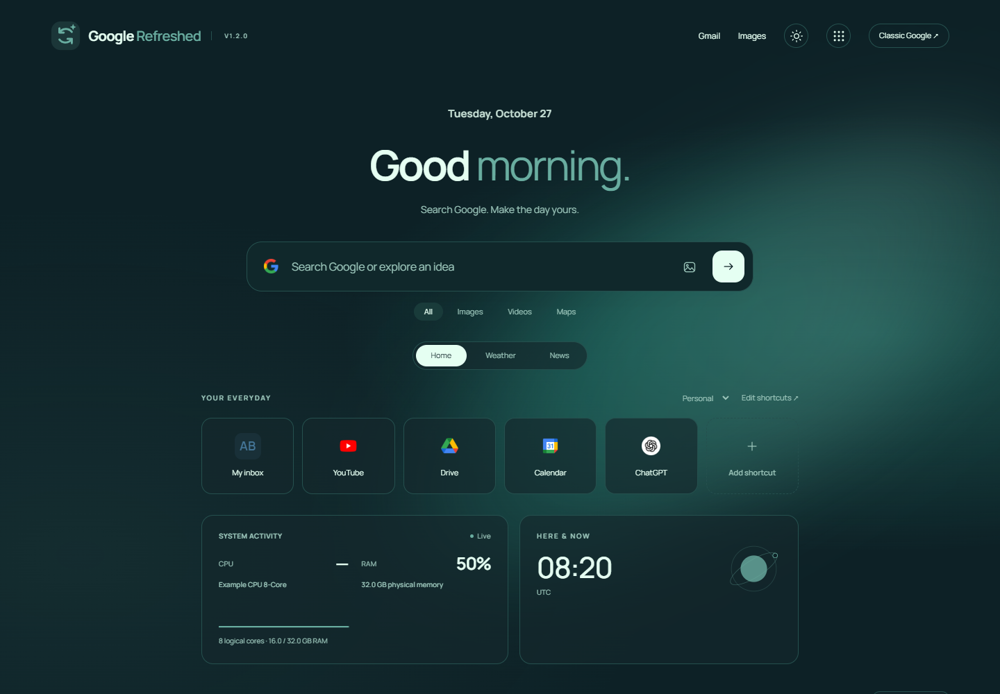

# GoogleRefreshed

A customizable Google homepage and matching Google results theme for Brave and Chromium.



## What it adds

- **17 distinct themes**, including Mystic, Solar, Aurora, Futuristic, and seasonal looks.
- Independent light/dark/system appearance, custom accents, and a local background photo.
- A font selector: locally bundled Manrope, Inter, Outfit, plus System UI and Georgia.
- Google-style suggestions with entity photos when Google supplies them, keyboard navigation, and an image-search button.
- Google search-result pages keep your selected palette while retaining Google's native results and controls.
- Editable shortcuts with a pencil on each card, custom names, URLs, icons, colors, and Personal/Work/Study groups.
- Ctrl+K commands and an optional clock.
- An on-device CPU/RAM monitor with the CPU model, installed memory capacity, logical-core count, and usage graphs. The optional focus note remains available.
- Automatic approximate weather location, manual city search, temperature units, and a five-day forecast.
- Local photo news, selectable sources/topics, lazy thumbnails, and **Show more articles** without another feed request.
- Settings import/export and visible version labels.

## Install or update

Download the extension ZIP from [Releases](https://github.com/youval1234/GoogleRefreshed/releases/latest), extract it into a permanent folder, then open **brave://extensions**, enable **Developer mode**, and choose **Load unpacked**. Select the folder containing manifest.json.

For an update, replace the files in that same folder, click **Reload** on the extension card, and refresh Google. v1.2 adds the system.cpu and system.memory permissions for the hardware monitor. The GitHub update button opens Releases; it is not an automatic installer or version checker.

## Matching the whole browser

The extension automatically keeps its palette on Google home and result pages. Brave's native toolbar and tabs use a separate Chromium theme; extensions cannot automatically synchronize that native theme with changing page palettes.

Use **Download matching browser theme** in Customize, save its manifest.json in a separate folder, and load that folder at brave://extensions. Alternatively, download the browser-themes ZIP from Releases and load one of its 34 light/dark theme folders. This is a manual companion theme. Disabling GoogleRefreshed does not automatically remove an installed companion theme. Other websites retain their own styles.

## Privacy

Brave Shields and browser privacy settings are unchanged. The extension requests storage, CPU/memory metadata, access to the named Google pages, and the specific weather/news/location providers in its manifest. It does not request history, cookies, GPS, microphone, bookmarks, all-site access, native messaging, or browser-management permissions.

CPU/RAM metrics and the focus note render inside an extension-origin frame. Google page scripts cannot read that frame's DOM. Hardware samples are not sent to providers or saved to extension storage. The monitor pauses in hidden tabs and when its frame leaves view. Uploaded photo bytes are rendered inside a closed shadow tree, rather than exposed in the page's inspectable background style. A chosen greeting and general UI preferences are still visible parts of the Google page.

With autocomplete enabled, typed prefixes go to Google before submission. Rich entity images come from Google's image CDN. Suggestions have a small, temporary in-memory cache; no persistent search history is saved. Normal search still submits to Google.

Opening Weather or News can perform an approximate city lookup through ipwho.is. No GPS permission is used; a VPN can affect the detected city. Finding a city sends its name to Open-Meteo; forecasts send the city coordinates to Open-Meteo. News sends the selected edition/topic and, for local headlines, a city/country query to the selected provider. These providers receive your IP address. Automatic location, suggestions, news images, and individual cards/tabs can be disabled.

Local photo news defaults to Bing News. BBC and Guardian photo feeds and Google News are also available. Google News RSS has no article thumbnails, so its entries remain compact text cards. Publisher thumbnails are lazy-loaded with no page referrer; Brave can block them. Requests use no saved account credentials. There are no analytics, remote scripts, or runtime Google Fonts requests.

Settings, notes, and uploaded photos stay in extension-local storage. Exports contain those settings and should be kept private. The original Google page still loads beneath the custom homepage. See [SECURITY_REVIEW.md](SECURITY_REVIEW.md) for the publication review and [THIRD_PARTY_NOTICES.md](THIRD_PARTY_NOTICES.md) for provider/font notices.

## Performance

The network worker is event-driven, with no polling loop. Weather/news have a bounded four-entry, 20-minute session cache; approximate location is cached separately. Autocomplete is debounced 250 ms and cancels stale requests. Hardware samples run every 2.5 seconds only while the monitor is in view, and keep at most 24 samples. The clock updates at minute boundaries. Animations use CSS opacity/transforms, pause in hidden tabs, and respect reduced motion. Provider responses and imports are size-limited.

## Development

The extension has no build step and no runtime npm dependencies. Node.js is needed for the preview/tests; Python 3 packages releases. Pillow is needed only for icon generation and the publication scanner.

```
npm install
npm run preview
npm test
npm run test:live
npm run package
```

Preview: http://127.0.0.1:4177/preview.html. It uses its own localStorage, a loopback-only proxy, and local OS metadata for hardware. It does not install the extension.

Tests use fresh isolated Brave profiles and synthetic feed/hardware fixtures. Set BRAVE_PATH to override the default Windows Brave executable; PLAYWRIGHT_MODULE can point to an existing Playwright installation. test:live makes actual provider requests, including approximate location, but does not record the detected city, coordinates, raw IP, or headlines. Demo screenshots use neutral fixtures.

The release packager uses an explicit runtime-file allowlist. Browser profiles, settings exports, environment files, signing keys, generated packages, and local development helpers are excluded from Git. Never commit credentials or personal test data.
