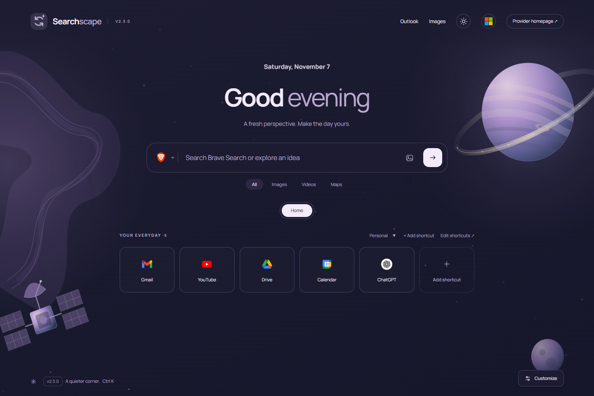
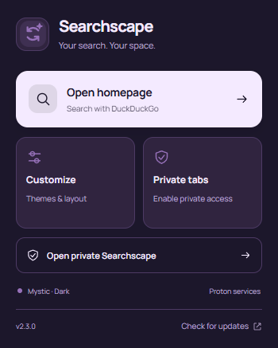
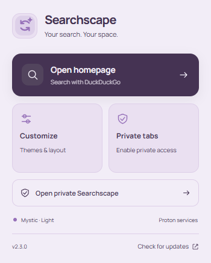

# Searchscape

**Your search. Your space.** An interactive homepage for Brave and Chromium, with animated worlds, draggable shortcuts, and your choice of search engine.

[Download the latest release](https://github.com/youval1234/Searchscape/releases/latest) · [Theme gallery](docs/v160) · [Report an issue](https://github.com/youval1234/Searchscape/issues)



## Make your browser feel like yours

- **52 animated themes** in nine collections, each with light and dark palettes. Search themes, choose an accent, add a local photo, and select from 12 fonts.
- **Six search options:** Google, DuckDuckGo, Brave Search, Bing, Ecosia, and a configurable SearXNG instance. This controls Searchscape searches; your address-bar engine stays in Brave settings.
- **Up to 60 shortcuts** with drag-to-reorder, touch grips, keyboard movement, custom names and icons, and Personal/Work/Study groups. Ordering saves automatically.
- **110 service links in nine ecosystems:** Google, Microsoft, Apple, Proton, Amazon, Adobe, Zoho, Meta, and Yahoo. Switch services independently of your search engine, or search the selected collection by app name. SharePoint, To Do, Forms, Planner, Loop, Copilot and other work apps are included; work/school or admin access may be needed. Bundled icons work without a cached favicon. [Service catalog](docs/services.md)
- **Useful daily tools:** optional CPU/RAM activity, world clock, focus timer or note, local weather, and customizable news with photos and more articles.
- **Brief, responsive motion:** a circular light/dark reveal, sliding shortcut cards, and tab/launcher transitions. Effects pause where appropriate and respect reduced motion and the animation toggle.
- **Search conveniences:** optional Google autocomplete, keyboard navigation, and reverse-image search through Google Lens. Google results can follow the selected palette, with contrast repairs for AI links and colored prompts.
- **Settings that stay yours:** local preferences, import/export, reset-to-default, and optional built-in browser sync where supported.

## A popup that matches your theme

Open the homepage, customize it, or jump directly to private-tab setup. The popup displays the selected engine, theme and ecosystem, and follows the saved light/dark appearance. Setup parameters are removed from the visible homepage address after loading; Brave still shows the required extension origin.

<p>
  
  
</p>

## Install or update

1. Download **Searchscape-v2.3.0.zip** from [Releases](https://github.com/youval1234/Searchscape/releases/latest) and extract it into a permanent folder.
2. Open `brave://extensions`, enable **Developer mode**, and choose **Load unpacked**.
3. Select the extracted folder containing `manifest.json`, then open a new tab. Brave may ask you to confirm the new-tab change.

To update, replace the files in the **same unpacked folder**, reload the extension, and open a fresh tab. Reusing the folder preserves the extension ID and local settings. The GitHub update button opens Releases; it does not install updates automatically.

Formerly GoogleRefreshed. Older settings exports remain compatible. An existing checkout or unpacked folder may still be called `still-home`; you do not need to rename it.

## Private windows

1. In Brave’s extension details, enable **Allow in Private** for Searchscape.
2. Click the Searchscape toolbar icon → **Private tabs**.
3. Enable **Open Searchscape automatically in private new tabs** and grant the optional tab-address permission.
4. If changing private access does not take effect, fully exit and restart Brave.

Chromium does not support a native private New Tab override. The opt-in feature instead navigates from browser-owned private new-tab URLs to the local Searchscape homepage, leaving existing tabs, links and searches alone. The popup’s **Open homepage** action is also available manually.

The toolbar popup also has **Open private Searchscape**, which launches directly at the extension URL. The normal private-window shortcut can still briefly show Brave’s protected start page before its redirect event runs; caching reduces repeated permission/settings lookups but cannot guarantee a flash-free redirect.

Redirect logic and permission-flow checks pass. The automatic private redirect is **not yet verified end to end in a live private window**; automatic review blocked that test command. [Validation details](SECURITY_REVIEW.md)

## SearXNG and toolbar themes

Choose **SearXNG** in Customize, then enter the URL of an instance you trust. HTTPS and HTTP localhost are supported, including subdirectory installations. The instance address stays local and is excluded from preference sync. Searches navigate directly to that server.

Searchscape can generate a matching native toolbar theme, installed separately in Brave. Automatic toolbar color updates are not available through Brave’s public extension APIs. We tested installed-theme switching in a disposable profile; it is not a verified palette-library solution. [Workarounds and test results](docs/toolbar-sync-options.md)

## Privacy and performance

The new-tab homepage, fonts, service icons and theme artwork load locally. There are no analytics or remote executable scripts. Searchscape does not change Brave Shields, Tor, cookie controls, or the browser’s address-bar search engine.

Optional online features contact their providers: Google autocomplete sends typed prefixes when Google is selected; Lens receives an image only when you submit it; weather uses Open-Meteo; approximate location uses ipwho.is; news uses the selected feed and image hosts. These providers receive the requests and your IP address. Features can be disabled, and manual location is available. Requests made by extension workers should not be assumed to use Tor.

Custom sites outside the bundled icon catalog use Brave’s native favicon cache. If a logo is generic, open that website once and refresh Searchscape. Explicit custom initials are also supported.

Names, notes, uploaded photos, location coordinates, hardware samples and the SearXNG instance address are excluded from browser preference sync. Sync delivery depends on your browser and extension ID; export/import is a manual alternative. Exports can contain personal settings and photos.

The event-driven worker does not continuously poll. Weather/news caching is bounded; autocomplete cancels stale requests; hardware samples only while its panel is visible; only the selected scene is mounted. [Security review](SECURITY_REVIEW.md) · [Third-party notices](THIRD_PARTY_NOTICES.md)

## Development

There is no build step or runtime npm dependency. Node.js runs the preview and browser tests; Python 3 packages releases. The publication scanner also uses Pillow.

```sh
npm install
npm run preview
npm test
npm run package
```

Preview: `http://127.0.0.1:4177/preview.html`. It uses separate localStorage and is not an installed extension. Set `BRAVE_PATH` to override the default Windows Brave executable. Tests use isolated profiles and fixtures; `npm run test:live` contacts actual providers. Documentation screenshots use nonpersonal settings with hardware and location hidden.

Release packaging uses an explicit runtime allowlist. Test profiles, exports, environment files and local helpers are excluded. [Recent changes](CHANGELOG.md)

## License

Original code and theme artwork are available under the [MIT license](LICENSE). Bundled fonts and third-party service assets retain their own notices; see [NOTICE.md](NOTICE.md).
