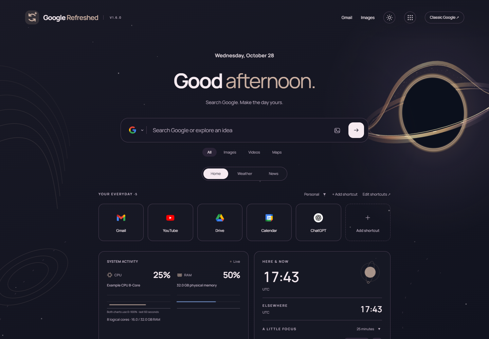

# GoogleRefreshed

A customizable Google homepage and matching Google results theme for Brave and Chromium.



## What it adds

- **52 original themed worlds** with light/dark palettes and unique animation. New: **Le Rouge**, an organic horror department store with ivory sculpture, sinewy crimson fabric and dramatic spotlights; and **Fashion**, a refined couture atelier with tailored garments, pleated fabric and a mood board. [Preview both themes](docs/v161).
- **12 detailed scene rebuilds**: Ocean, Spring, Midnight, Cosmic, Amber, Ice, Colorful, Sunset, Library, Office, Science and Scary. [View the light/dark gallery](docs/v160).
- A searchable theme picker with **nine curated collections**, collection filtering and clear empty results.
- An optional first-run name prompt with skip support. Your display name stays local and can be changed in Customize. Greetings follow the local clock, including “Still up” overnight and “Enjoy your night” late in the evening. English greetings and RTL names keep their correct reading order.
- Independent light/dark/system appearance (System by default, following the OS), custom accents, and a local background photo.
- **12 font choices**: bundled Manrope, Inter, Outfit, Roboto, DM Sans, Space Grotesk, and Lora; plus classic Google-style Arial, the original Georgia homepage heading font, System UI, Verdana, and Trebuchet MS. Font files load locally only when selected.
- Google-style suggestions with entity photos when Google supplies them and keyboard navigation. The search-bar image button opens a themed reverse-image dialog: upload an image or paste an image link to search with Google Lens. The Images tab retains normal text-based image search.
- Choose Google, DuckDuckGo, Brave Search, Bing, or Ecosia from the search box or Customize. Web, image, and video queries use the selected engine. Maps and reverse image search use Google; this does not change Brave’s address-bar default.
- Google result pages keep the selected palette while retaining native controls. Neutral surfaces and AI response text are themed at their point of use, preserving shared Google color-variable definitions and readable text contrast.
- An optional **Open GoogleRefreshed in every new tab** toggle in Customize. Brave asks for the optional tabs permission only when you turn it on, and the permission is released when you turn it off.
- Up to **60 editable shortcuts**, with multiple rows, a visible Add shortcut button, a pencil on each card, custom names, URLs, icons, colors, and Personal/Work/Study groups.
- Ctrl+K commands, a clock with a configurable second time zone, and a start/pause/reset focus timer. Timer state stays local and survives page reloads. The world clock and timer can be hidden independently.
- An on-device CPU/RAM monitor with CPU/RAM icons, CPU model, installed memory capacity, logical-core count, and aligned usage graphs. Interrupted samples retain the last reading and recover automatically. The secondary GPU/network/unavailable-temperature block has been removed. The optional focus note remains available.
- Automatic approximate weather location, manual city search, temperature units, and a five-day forecast.
- Local photo news, selectable sources/topics, lazy thumbnails, and **Show more articles** without another feed request.
- Opt-in browser settings sync where supported, settings import/export, and visible version labels. **Reset settings to default** is at the top of Customize. Confirm with a second click to restore homepage defaults, clear local personalization, stop the focus timer, and disable optional settings sync.

## Install or update

Download the extension ZIP from [Releases](https://github.com/youval1234/GoogleRefreshed/releases/latest), extract it into a permanent folder, then open **brave://extensions**, enable **Developer mode**, and choose **Load unpacked**. Select the folder containing manifest.json.

For an update, replace the files in that same folder, click **Reload** on the extension card, and refresh Google. v1.2 adds the system.cpu and system.memory permissions for the hardware monitor. The GitHub update button opens Releases; it is not an automatic installer or version checker.

Version 1.5.4 starts new installations in System appearance, so Google opens in the operating system's light or dark mode. Existing appearance choices are kept. It also adds an optional toggle that opens GoogleRefreshed in every new tab.

Version 1.3.1 fixes the hardware panel retaining a light palette or painting an opaque white canvas when System mode switches to dark. The frame and homepage now use the same color scheme, including live system changes.

Version 1.3 starts the homepage cover at document start to prevent the native Google homepage flashing before customization. It also recolors neutral Google result cards and AI-overview gradients, aligns CPU/RAM graph areas even with long model names, repairs malformed feed entities, and falls back from an unavailable Bing feed to clearly attributed BBC coverage. BBC fallback coverage may differ from your chosen local edition.

## Settings across devices

In **Customize → Across your devices**, enable **Use browser settings sync** on each device. Appearance, font/search-engine choices, shortcuts, and widget/feed preferences use the browser's `chrome.storage.sync` service. Your greeting name, notes, uploaded photos, selected city/coordinates, focus-timer state, and hardware data stay local. Shortcut destinations and custom news topics are included, so enable this only if you want those preferences shared with your browser's sync service.

Both installations need the same extension ID and a browser service that synchronizes extension storage. The ID is shown in Customize. Unpacked extensions can receive different IDs when installed from different paths. This update preserves your existing ID and local settings; it does not silently replace the manifest with a different key. Brave may expose the API without transporting extension preferences between devices. **Saved to browser sync storage** confirms a local API write, not delivery to another device. Enable browser sync separately; no custom account, server, or native companion is added. A preference update received from the browser applies automatically. Existing synced preferences take precedence when enabling sync; subsequent updates use whole preference bundles, so simultaneous edits can overwrite one another.

There is an 8 KB per-item browser limit. Oversized shortcuts produce a visible error and remain saved locally. **Export settings / Import settings** remains available for manual transfer, different extension IDs, and browsers without compatible sync. Disabling sync stops subsequent reads/writes; it does not remove a previously saved copy from your browser's sync storage.

## Browser-only hardware limits

The graph areas share a 0–100% vertical scale and a common sample timeline; CPU and RAM values naturally differ. This monitor shows CPU and memory readings only. Brave on Windows does not expose CPU/GPU temperatures or GPU utilization through these extension APIs. No Windows companion is installed.

API references: [extension storage and quotas](https://developer.chrome.com/docs/extensions/reference/api/storage), [CPU metadata and temperature availability](https://developer.chrome.com/docs/extensions/reference/api/system/cpu). Brave also tracks an [extension-settings sync issue](https://github.com/brave/brave-browser/issues/46983); support for cross-device extension preferences should be verified in your browser version.

## Matching the whole browser

The extension automatically keeps its palette on Google home and result pages. Brave's native toolbar and tabs use a separate Chromium theme. GoogleRefreshed does not change those colors directly: its matching themes are separate packages. The management API can enable already-installed themes with additional permission, but Brave's removal of inactive themes prevents the reliable full-library switcher tested here. This extension does not request that permission.

Use **Download matching browser theme** in Customize, save its manifest.json in a separate folder, and load that folder at brave://extensions. Alternatively, download the browser-themes ZIP from Releases and load one of its 100 light/dark theme folders. This is a manual companion theme. To remove it, open **brave://settings/appearance → Theme → Reset to default**. Disabling GoogleRefreshed does not automatically remove an installed companion theme. Other websites retain their own styles.

## Privacy

Brave Shields and browser privacy settings are unchanged. The extension requests storage, CPU/memory metadata, access to the named Google pages, and the specific weather/news/location providers in its manifest. It does not request history, cookies, GPS, microphone, bookmarks, all-site access, native messaging, or browser-management permissions. The tabs permission is optional and is requested only if you enable **Open GoogleRefreshed in every new tab**; Brave describes it as reading browsing history. GoogleRefreshed uses it only to compare a newly created tab's address with the browser's new-tab page and never stores or sends tab addresses.

CPU/RAM metrics and the focus note render inside an extension-origin frame. Google page scripts cannot read that frame's DOM. Hardware samples are not sent to providers or saved to extension storage. The monitor pauses in hidden tabs and when its frame leaves view. Uploaded photo bytes are rendered inside a closed shadow tree, rather than exposed in the page's inspectable background style. A chosen greeting and general UI preferences are still visible parts of the Google page.

With Google selected and autocomplete enabled, typed prefixes go to Google before submission. Choosing any other search engine disables these Google autocomplete requests. Rich entity images come from Google's image CDN. Suggestions have a small, temporary in-memory cache; no persistent search history is saved. Submitted text queries go to the selected search provider. Reverse-image searches send the chosen file or image URL directly to Google Lens only when you press its search button. The extension does not read image bytes into its photo cache or save image-search files/links to local or sync storage. Closing the dialog clears the selected file and URL. Uploads support JPG, PNG, WebP, GIF, and AVIF up to 20 MB.

Opening Weather or News can perform an approximate city lookup through ipwho.is. No GPS permission is used; a VPN can affect the detected city. Finding a city sends its name to Open-Meteo; forecasts send the city coordinates to Open-Meteo. News sends the selected edition/topic and, for local headlines, a city/country query to the selected provider. These providers receive your IP address. Automatic location, suggestions, news images, and individual cards/tabs can be disabled.

Local photo news defaults to Bing News. BBC and Guardian photo feeds and Google News are also available. Google News RSS has no article thumbnails, so its entries remain compact text cards. Publisher thumbnails are lazy-loaded with no page referrer; Brave can block them. Requests use no saved account credentials. There are no analytics, remote scripts, or runtime Google Fonts requests.

Settings and focus-timer state are saved locally by default. Opt-in sync shares only the preference fields listed above. Notes and uploaded photos stay in extension-local storage. Exports contain those settings and should be kept private. The original Google page still loads beneath the custom homepage. See [SECURITY_REVIEW.md](SECURITY_REVIEW.md) for the publication review and [THIRD_PARTY_NOTICES.md](THIRD_PARTY_NOTICES.md) for provider/font notices.

## Performance

The network worker is event-driven, with no polling loop. Weather/news have a bounded four-entry, 20-minute session cache; approximate location is cached separately. Autocomplete is debounced 250 ms and cancels stale requests. Hardware samples run every 2.5 seconds only while the monitor is in view, and keep at most 24 samples. The clocks update at minute boundaries. The focus timer updates once a second while running and visible; its deadline is saved locally and resumes accurately after a hidden tab or reload. Scenery mounts only the selected vector scene and reuses a bounded 48-particle pool. Animations primarily use CSS opacity/transforms, with a few stroke-drawing effects. They pause in hidden tabs, respect reduced motion, and offer Vivid/Subtle intensity. Reused blossom shapes and bounded skyline window animations avoid duplicating heavy scenes. A quiet center mask keeps scenery from competing with search and text. Provider responses and imports are size-limited.

## Development

The extension has no build step and no runtime npm dependencies. Node.js is needed for the preview/tests; Python 3 packages releases. Pillow is needed only for icon generation and the publication scanner.

```
npm install
npm run preview
npm test
npm run test:live
npm run package
```

Preview: http://127.0.0.1:4177/preview.html. It uses its own localStorage, a loopback-only proxy, and local OS metadata for hardware. It does not install the extension.

Tests use fresh isolated Brave profiles and synthetic feed/hardware fixtures. Set BRAVE_PATH to override the default Windows Brave executable; PLAYWRIGHT_MODULE can point to an existing Playwright installation. test:live makes actual provider requests, including approximate location, but does not record the detected city, coordinates, raw IP, or headlines. Demo screenshots use neutral fixtures.

The release packager uses an explicit runtime-file allowlist. Browser profiles, settings exports, environment files, signing keys, generated packages, and local development helpers are excluded from Git. Never commit credentials or personal test data.

## License

Original code and theme artwork are available under the [MIT license](LICENSE). Bundled fonts and third-party service assets retain their own notices; see [NOTICE.md](NOTICE.md).
