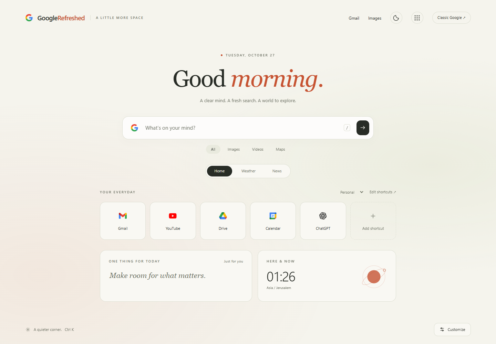

# GoogleRefreshed

A customizable Google homepage for Brave and Chromium, built with vanilla JavaScript and CSS.



## Features

- **16 themes:** Paper, Sage, Ocean, Rose, Futuristic, Mystic, Magical, Rustic, Spring, Summer, Autumn, Winter, Midnight, Aurora, Cosmic, and Noir.
- Independent light, dark, and system modes, custom accents, and a local background photo.
- CSS entrance, hover, and ambient animations, with a motion switch and reduced-motion support.
- Google-style autocomplete with keyboard navigation, plus All, Images, Videos, and Maps search destinations. Original service icons are bundled locally.
- Personal, Work, and Study shortcut groups; rename, reorder, and remove links.
- Ctrl+K command palette for shortcuts, themes, appearance, tabs, and settings. Press / to focus search.
- Optional clock and focus note.
- Weather tab: automatic approximate location, manual city search, Celsius/Fahrenheit, current conditions, and a five-day forecast.
- News tab: local headlines, editions, languages, topics, custom search, headline count, and optional photos from BBC/Guardian feeds. Google News RSS has no photos, so it uses category placeholders.
- Settings import/export, reset, and a GitHub release link for updates.

GoogleRefreshed runs on the homepages of google.com and google.co.il, including /webhp. Search results and other Google pages are left untouched. It does not change Brave's homepage preference or new-tab page. **Classic Google** restores the original homepage for native suggestions, voice search, Lens, and the account menu. **Back to GoogleRefreshed** restores the design.

## Install in Brave

1. Download the ZIP from the [latest private release](https://github.com/youval1234/GoogleRefreshed/releases/latest) and extract it into a permanent folder. Or clone this repository and use its extension folder.
2. Open brave://extensions and enable **Developer mode**.
3. Click **Load unpacked** and select the folder containing manifest.json.
4. Refresh https://www.google.com/.

Keep the selected folder in place. Customize using the bottom-right button, the header light/dark button, or Ctrl+K. Changes save automatically in this browser.

## Update

Use **Check GitHub for updates** in Customize or the extension popup. It opens this private repository's latest release using your signed-in GitHub browser. Compare its version with the installed version displayed beside the button. Replace the installed files with the release files, click **Reload** at brave://extensions, and refresh Google. Keep the same folder to preserve the extension ID and settings.

This is a release-page link, not an automatic version checker or installer. No GitHub token is embedded or requested. Source changes appear as updates after a tagged release is published.

## Privacy and performance

Brave Shields and browser privacy settings are unchanged. No history, cookies, microphone, GPS/geolocation, bookmarks, or browser-management permissions are requested. No analytics, remote scripts, frameworks, or remote fonts are used.

Preferences and photos live in chrome.storage.local. Exports include your note, selected city, and photo; keep exports private. With autocomplete enabled, typed prefixes go to Google for suggestions before submission; this can be switched off. GoogleRefreshed keeps only a small temporary in-memory suggestion cache, with no search history in extension storage. Full searches go to Google when submitted. Shortcut and article destinations open when selected. Google's original page still loads beneath the design.

Opening Weather or News can perform an IP-based city lookup through [ipwho.is](https://ipwhois.io/). It returns an approximate city, not GPS location, and may reflect a VPN exit location. The raw IP address is not stored by the extension. Automatic weather location and local news can be disabled separately. Manual city selection disables automatic weather selection, and manually choosing a news edition disables automatic news edition selection.

Finding a city sends its name to Open-Meteo's geocoding service; forecasts send city coordinates to Open-Meteo. News sends the selected edition, language, and topic (including city/country for local headlines) to Google News. Providers receive the requester's IP address. Optional news thumbnails also contact the publisher's image CDN, with no page referrer sent; images load lazily and respect Brave Shields. Hide either tab to avoid using it. None of these requests run while simply viewing Home.

The event-driven background worker has no polling timers and can sleep between requests. Weather/news results are cached for 20 minutes in a bounded session cache with at most four entries; approximate location is cached for up to 24 hours within the browser session. Text edits are saved with a short debounce. The clock updates at minute boundaries and stops in hidden tabs. Motion also pauses when the tab is hidden. Ambient effects use CSS opacity/transforms and at most ten seasonal particles. Photos are resized to a maximum dimension of 1920 pixels. Actual browser memory varies by page, device, and photo.

Brave toolbar colors are separate from page colors. System appearance follows the system's light/dark preference; it does not copy a custom Brave toolbar palette.

## Development

The extension has no build step or runtime npm dependencies. Node.js is needed for the local preview and tests; Python 3 is needed to package a release. Pillow is only needed to regenerate the extension icon.

```
npm install
npm run preview
```

Open http://127.0.0.1:4177/preview.html. The preview stores its settings separately in localStorage and proxies data through a local server bound only to 127.0.0.1. It does not install the extension.

```
npm test
npm run package
```

Tests use Playwright and isolated Brave profiles. The default executable is C:/Program Files/BraveSoftware/Brave-Browser/Application/brave.exe; set BRAVE_PATH to override it. PLAYWRIGHT_MODULE can point to an existing Playwright installation. Controlled Google and feed fixtures verify behavior, not the accuracy of external live data. Profiles, exports, dependencies, and generated packages are excluded from Git.

Release ZIPs contain runtime files only, with manifest.json at the root. Third-party icons and data sources are documented in [THIRD_PARTY_NOTICES.md](THIRD_PARTY_NOTICES.md).
