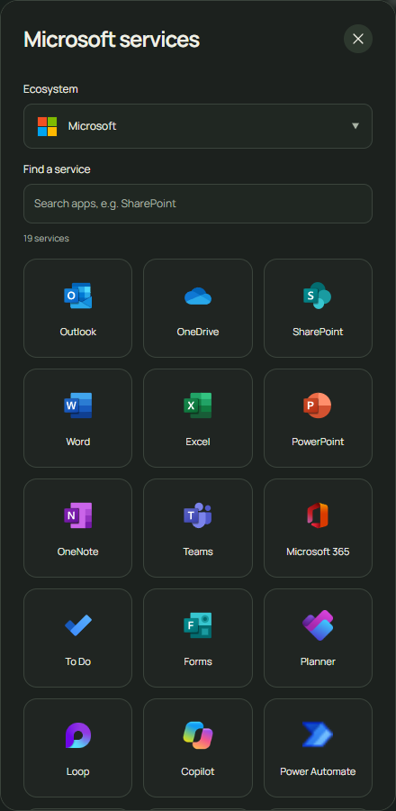

# Service catalog

Searchscape includes 110 fixed service links across nine ecosystems. Use the service search box to find an app without scrolling through the complete collection. Choosing an ecosystem does not change the selected search engine.

SharePoint opens Microsoft’s work-account launcher. Access depends on your organization and account; Searchscape does not guess or collect a tenant URL. You can also add your organization’s own SharePoint site as a custom homepage shortcut. SharePoint and OneDrive tenant domains receive their respective bundled icons.

| Ecosystem | Services |
| --- | --- |
| Google (21) | [Gmail](https://mail.google.com/) · [YouTube](https://www.youtube.com/) · [Drive](https://drive.google.com/) · [Calendar](https://calendar.google.com/) · [Docs](https://docs.google.com/document/) · [Maps](https://maps.google.com/) · [Photos](https://photos.google.com/) · [Translate](https://translate.google.com/) · [Sheets](https://docs.google.com/spreadsheets/) · [Slides](https://docs.google.com/presentation/) · [Forms](https://docs.google.com/forms/) · [Meet](https://meet.google.com/) · [Keep](https://keep.google.com/) · [Contacts](https://contacts.google.com/) · [News](https://news.google.com/) · [Finance](https://www.google.com/finance/) · [Gemini](https://gemini.google.com/) · [Classroom](https://classroom.google.com/) · [Tasks](https://tasks.google.com/) · [Chat](https://chat.google.com/) · [Account](https://myaccount.google.com/) |
| Microsoft (19) | [Outlook](https://outlook.live.com/) · [OneDrive](https://onedrive.live.com/) · [SharePoint](https://www.microsoft365.com/launch/sharepoint) · [Word](https://word.cloud.microsoft/) · [Excel](https://excel.cloud.microsoft/) · [PowerPoint](https://powerpoint.cloud.microsoft/) · [OneNote](https://www.onenote.com/) · [Teams](https://teams.microsoft.com/) · [Microsoft 365](https://m365.cloud.microsoft/) · [To Do](https://to-do.office.com/tasks/) · [Forms](https://forms.office.com/) · [Planner](https://planner.cloud.microsoft/) · [Loop](https://loop.cloud.microsoft/) · [Copilot](https://copilot.microsoft.com/) · [Power Automate](https://make.powerautomate.com/) · [Lists](https://www.microsoft365.com/launch/lists) · [Outlook work](https://outlook.office.com/mail/) · [Admin center](https://admin.microsoft.com/) · [Account](https://account.microsoft.com/) |
| Apple (14) | [iCloud Mail](https://www.icloud.com/mail/) · [iCloud Drive](https://www.icloud.com/iclouddrive/) · [Photos](https://www.icloud.com/photos/) · [Calendar](https://www.icloud.com/calendar/) · [Notes](https://www.icloud.com/notes/) · [Reminders](https://www.icloud.com/reminders/) · [Pages](https://www.icloud.com/pages/) · [Find My](https://www.icloud.com/find/) · [Contacts](https://www.icloud.com/contacts/) · [Numbers](https://www.icloud.com/numbers/) · [Keynote](https://www.icloud.com/keynote/) · [Music](https://music.apple.com/) · [Apple TV](https://tv.apple.com/) · [Apple Account](https://account.apple.com/) |
| Proton (11) | [Proton Mail](https://mail.proton.me/) · [Calendar](https://calendar.proton.me/) · [Drive](https://drive.proton.me/) · [Pass](https://pass.proton.me/) · [Wallet](https://wallet.proton.me/) · [VPN](https://account.protonvpn.com/) · [Docs](https://docs.proton.me/) · [Sheets](https://sheets.proton.me/) · [Lumo](https://lumo.proton.me/) · [SimpleLogin](https://app.simplelogin.io/) · [Account](https://account.proton.me/) |
| Amazon (9) | [Amazon](https://www.amazon.com/) · [Prime Video](https://www.primevideo.com/) · [Music](https://music.amazon.com/) · [Photos](https://www.amazon.com/photos/) · [Kindle](https://read.amazon.com/) · [Audible](https://www.audible.com/) · [Twitch](https://www.twitch.tv/) · [Orders](https://www.amazon.com/gp/your-account/order-history) · [Account](https://www.amazon.com/gp/css/homepage.html) |
| Adobe (10) | [Creative Cloud](https://creativecloud.adobe.com/) · [Acrobat](https://acrobat.adobe.com/) · [Express](https://new.express.adobe.com/) · [Firefly](https://firefly.adobe.com/) · [Lightroom](https://lightroom.adobe.com/) · [Photoshop](https://photoshop.adobe.com/) · [Stock](https://stock.adobe.com/) · [Fonts](https://fonts.adobe.com/) · [Behance](https://www.behance.net/) · [Account](https://account.adobe.com/) |
| Zoho (11) | [Mail](https://mail.zoho.com/) · [Calendar](https://calendar.zoho.com/) · [Writer](https://writer.zoho.com/) · [Sheet](https://sheet.zoho.com/) · [WorkDrive](https://workdrive.zoho.com/) · [Meeting](https://meeting.zoho.com/) · [CRM](https://crm.zoho.com/) · [Notebook](https://notebook.zoho.com/) · [Vault](https://vault.zoho.com/) · [Cliq](https://cliq.zoho.com/) · [Account](https://accounts.zoho.com/) |
| Meta (7) | [Facebook](https://www.facebook.com/) · [Instagram](https://www.instagram.com/) · [WhatsApp](https://web.whatsapp.com/) · [Messenger](https://www.messenger.com/) · [Business Suite](https://business.facebook.com/) · [Threads](https://www.threads.com/) · [Account](https://accountscenter.facebook.com/) |
| Yahoo (8) | [Mail](https://mail.yahoo.com/) · [Finance](https://finance.yahoo.com/) · [News](https://news.yahoo.com/) · [Sports](https://sports.yahoo.com/) · [Yahoo](https://www.yahoo.com/) · [Calendar](https://calendar.yahoo.com/) · [Weather](https://www.yahoo.com/news/weather/) · [Account](https://login.yahoo.com/account/personalinfo) |

## References

- [Microsoft: sign in to SharePoint](https://support.microsoft.com/en-us/sharepoint/get-started-with-sharepoint/sign-in-to-sharepoint)
- [Apple: sign in and use iCloud.com](https://support.apple.com/guide/icloud/sign-in-and-use-icloudcom-mm281e3e7d/icloud)
- [Google Tasks](https://workspace.google.com/intl/en/products/tasks/)
- [Proton Sheets import and export](https://proton.me/support/sheets-import-export)
- [Adobe: access Behance](https://helpx.adobe.com/ca/creative-cloud/apps/integration-with-other-apps/behance-integration/access-behance.html)

Artwork sources are recorded in extension/icons/services/sources.json. App access, sign-in and subscriptions are handled on the provider’s own website.
