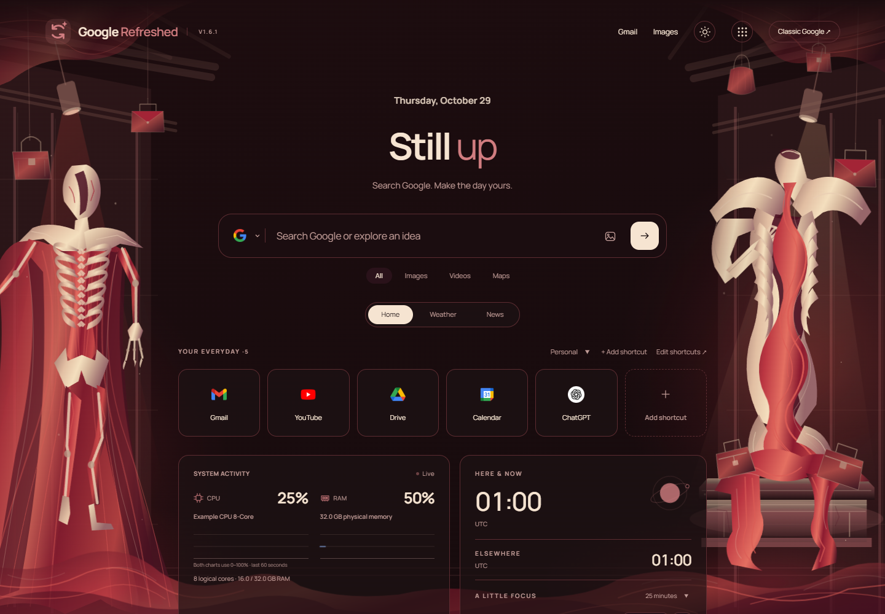
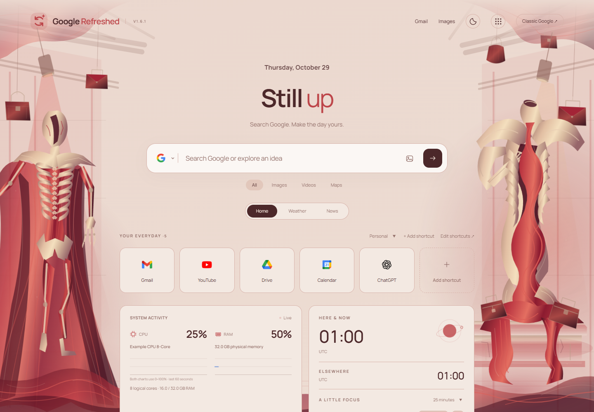
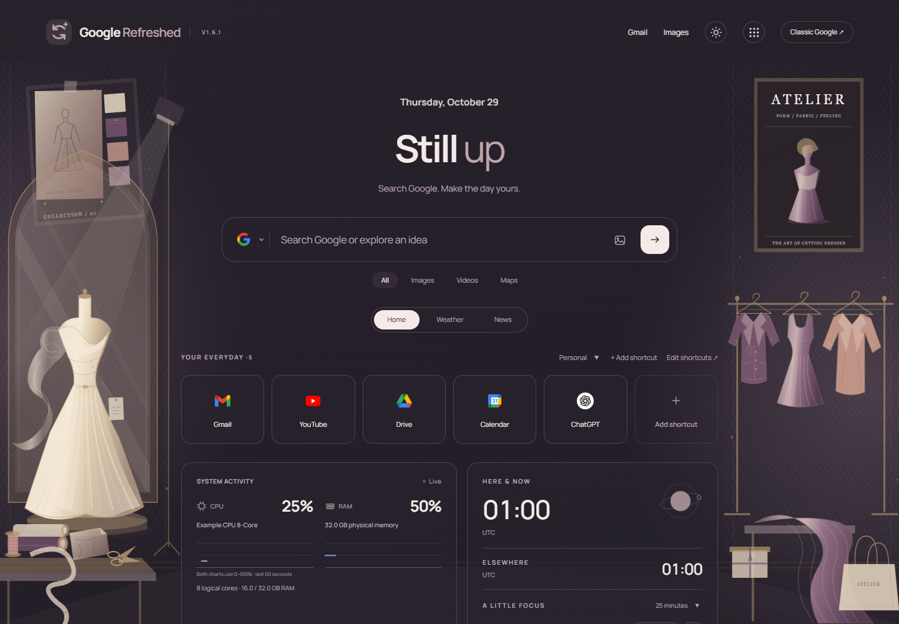
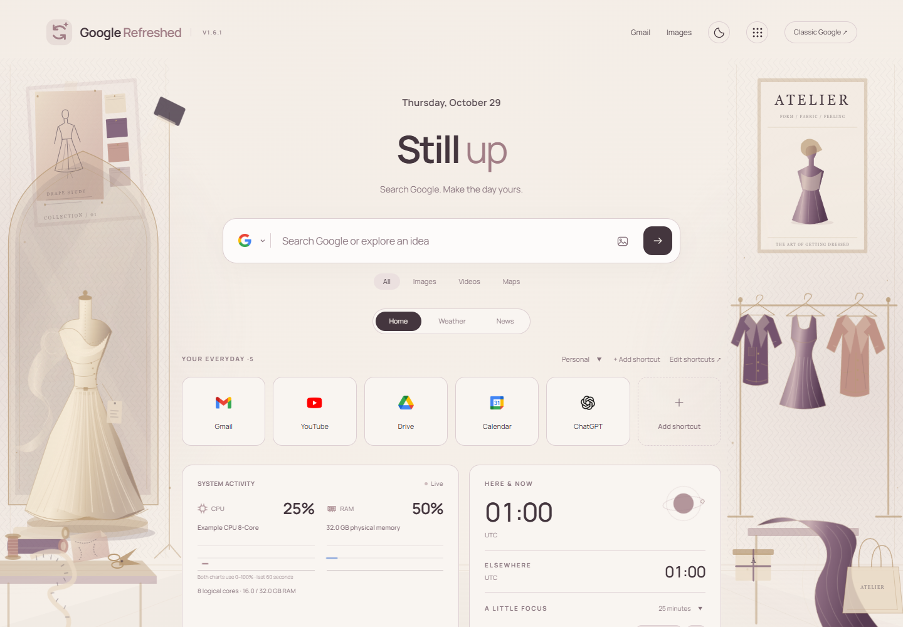
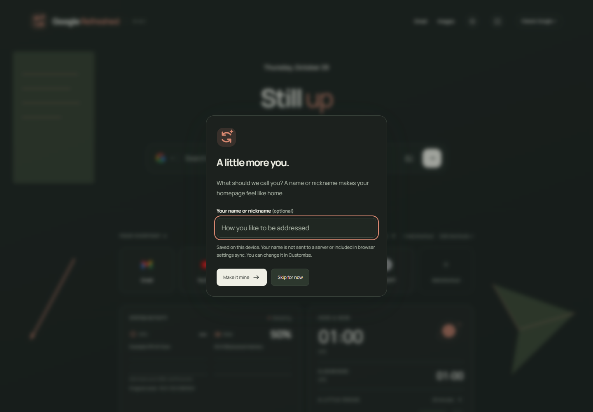

# GoogleRefreshed v1.6.1

Le Rouge is an organic horror department store with ivory rib-couture sculpture, sinewy crimson fabric, hanging bags, display plinths and dramatic spotlights. Fashion is a separate polished couture atelier with tailored garments, pleated fabric and a mood board. Both use original local vector artwork and distinct CSS animation, with support for animation off, reduced motion and hidden-tab pause.

## Le Rouge · Dark

## Le Rouge · Light

## Fashion · Dark

## Fashion · Light

Previews use synthetic hardware, UTC and no personal name or location.

## Optional first-run welcome

