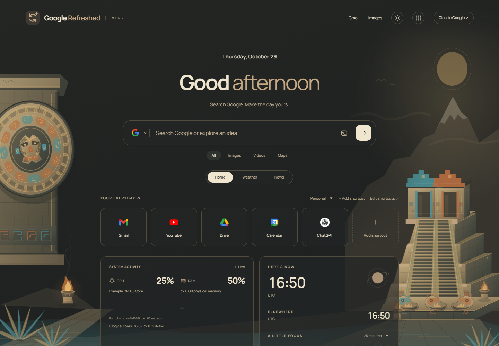
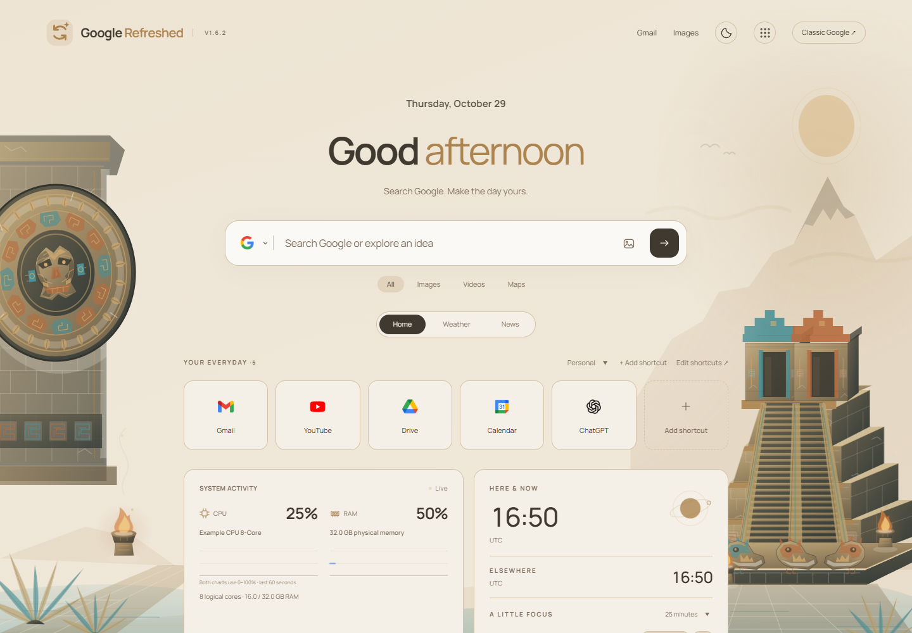
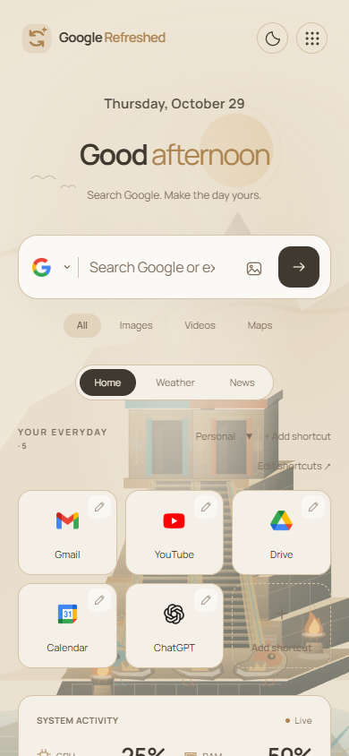

# Aztec redesign · GoogleRefreshed v1.6.2

A more detailed original architectural scene with layered temple terraces, carved stone reliefs, weathered masonry, serpent sculptures, painted accents, braziers and a lake landscape. Fire, incense, light, water and vegetation move independently, while the architecture stays anchored.

## Dark

## Light

## Narrow layout

The design draws on [INAH's Templo Mayor architecture and color references](https://www.templomayor.inah.gob.mx/images/templomayor/20170807_cedulas_ok.pdf). It is a stylized composition, rather than a reconstruction of a specific historical phase. All artwork is original local SVG; no museum images are packaged.

Previews use synthetic hardware, UTC and no personal name or location. [Previous Aztec design](../v160/aztec-dark.png).
